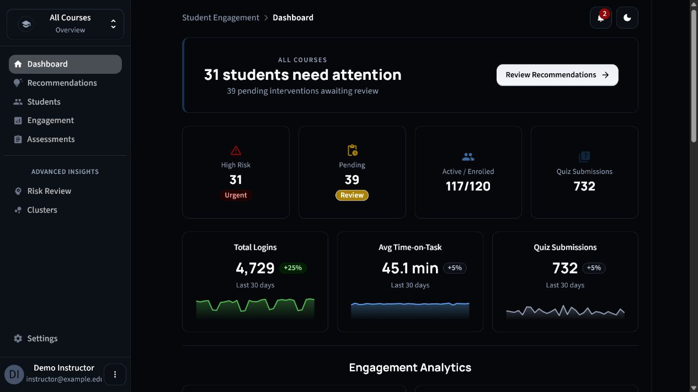
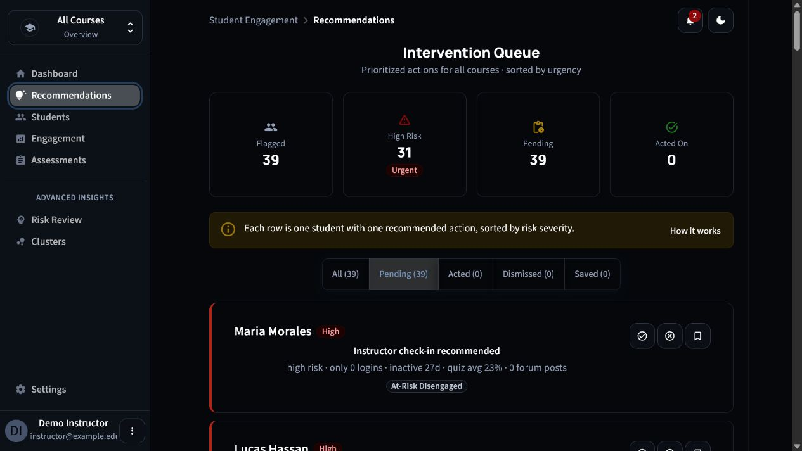

# Adaptive Analytics Dashboard

An instructor-facing learning analytics prototype for reviewing student
engagement, identifying risk signals, and managing intervention
recommendations. The project combines a React dashboard with a FastAPI
analytics service, transparent rule-based scoring, exploratory machine
learning, and a synthetic semester dataset.

Developed as a Final Year Project at The Education University of Hong Kong.

## Main Features

- Course-level dashboard with engagement, assessment, and risk summaries
- Global course filtering across the primary analytics views
- Student roster with risk scores, activity trends, and sortable data
- Transparent Low/Medium/High risk scoring with visible contributing factors
- Instructor recommendation queue with Act, Dismiss, and Save workflows
- Assessment comparisons, score distributions, and quiz-level breakdowns
- Decision-tree comparison with confidence and feature-importance diagnostics
- K-means behavioural clustering with PCA visualization and silhouette scoring
- Notifications, demo profile, display settings, and responsive navigation
- Deterministic synthetic data covering 120 students and five courses

## Screenshots

| Dashboard overview | Recommendation workflow |
| --- | --- |
|  |  |

## Technology

| Layer | Technologies |
| --- | --- |
| Frontend | React 19, Vite 8, Material UI, MUI X |
| Backend | FastAPI, Pydantic, Uvicorn |
| Data | SQLite, deterministic Python seed generator |
| Analytics | Custom rule engine, scikit-learn decision tree, K-means, PCA |
| Quality | ESLint, Python `unittest`, GitHub Actions |

## How It Works

The React application calls a FastAPI service through Vite's local `/api`
proxy. FastAPI queries SQLite and delegates analytics to focused Python
modules:

- `risk_scoring.py` computes the canonical, weighted risk score.
- `ml_model.py` compares decision-tree classifications against rule labels.
- `clustering.py` groups behavioural profiles for exploratory analysis.
- `recommendations.py` consolidates risk factors into instructor actions.

The rule-based model remains the source of truth because it is inspectable and
the project does not have institutionally validated outcome data. Machine
learning and clustering are supporting views, not automated decision makers.
See [the architecture note](docs/architecture.md) for the data flow and scoring
weights.

## Installation

### Prerequisites

- Node.js 20.19 or newer
- Python 3.10 or newer

### Backend

From the repository root:

```powershell
python -m venv .venv
.\.venv\Scripts\Activate.ps1
pip install -r backend\requirements.txt
cd backend
python seed.py
python ml_model.py
python -m uvicorn main:app --reload --port 8000
```

The API runs at `http://127.0.0.1:8000`. Interactive OpenAPI documentation is
available at `http://127.0.0.1:8000/docs`.

### Frontend

In a second terminal, from the repository root:

```powershell
npm install
npm run dev
```

Open `http://localhost:5173`.

## Usage

Use the clearly marked demo account:

- Email: `instructor@example.edu`
- Password: `demo-password`

Choose **All Courses** or a specific course from the sidebar. Review the
dashboard first, then use Recommendations for intervention actions, Students
for individual risk context, and Advanced Insights for model and clustering
comparisons.

The sign-in screen is a client-side demonstration gate. It is not secure
authentication and must be replaced before any real deployment.

## Project Structure

```text
analysis-dashboard/
|-- .github/workflows/       GitHub Actions checks
|-- backend/
|   |-- main.py              FastAPI endpoints
|   |-- database.py          SQLite schema and connection helpers
|   |-- seed.py              Synthetic semester data generator
|   |-- risk_scoring.py      Canonical weighted risk model
|   |-- ml_model.py          Decision-tree comparison model
|   |-- clustering.py        K-means and PCA analysis
|   |-- recommendations.py   Intervention rule engine
|   `-- tests/               Backend unit tests
|-- docs/                    Architecture and screenshots
|-- public/                  Static application assets
|-- src/
|   |-- dashboard/           Dashboard shell and visualizations
|   |-- pages/               Routed analytics workflows
|   |-- shared-theme/        MUI theme customizations
|   |-- api.js               Frontend API client
|   `-- auth.js              Demo-only sign-in state
|-- package.json
`-- vite.config.js
```

## Configuration

Copy `.env.example` to `.env` only when overriding the default API path:

| Variable | Default | Purpose |
| --- | --- | --- |
| `VITE_API_BASE_URL` | `/api` | Frontend API base path |
| `CORS_ORIGINS` | Local Vite origins | Comma-separated backend CORS origins |

Generated databases, trained model files, exported CSV files, environment
files, dependencies, and production builds are excluded from Git.

## Validation

Frontend:

```powershell
npm run check
```

Backend:

```powershell
python -m unittest discover -s backend/tests -v
```

CI performs the frontend lint/build and backend dependency, compilation, and
unit-test checks on every push and pull request to `main`.

## Known Limitations

- All student records and outcomes are synthetic.
- The decision tree is trained on rule-generated labels, so its reported
  accuracy is not evidence of predictive validity on real learners.
- The application uses demo-only client-side authentication.
- SQLite and the local process model are intended for a single-user prototype.
- The fixed demonstration date keeps seeded analytics reproducible.
- The frontend production bundle is functional but remains large because the
  charting and data-grid views are loaded together.

## Future Improvements

- Evaluate usability with instructors and refine recommendation wording
- Validate risk signals against governed, de-identified institutional data
- Add production authentication, authorization, and audit trails
- Add LMS connectors with consent, retention, and privacy controls
- Evaluate model fairness and calibration across course contexts
- Introduce route-level code splitting and browser end-to-end tests
- Replace SQLite with a production database for multi-user deployment

## Credits

The interface adapts component and theme patterns from the Material UI
dashboard template. Material UI, React, FastAPI, scikit-learn, and other
dependencies remain subject to their own licences. See
[THIRD_PARTY_NOTICES.md](THIRD_PARTY_NOTICES.md).

## Licence

Original project code is available under the [MIT Licence](LICENSE).

## Academic Disclaimer

This is an independent academic prototype and personal portfolio project. It
is not an official Education University of Hong Kong product, learning
management system, or student monitoring service. It must not be used to make
academic, welfare, or disciplinary decisions without institutional
validation, governance, and qualified human review.
