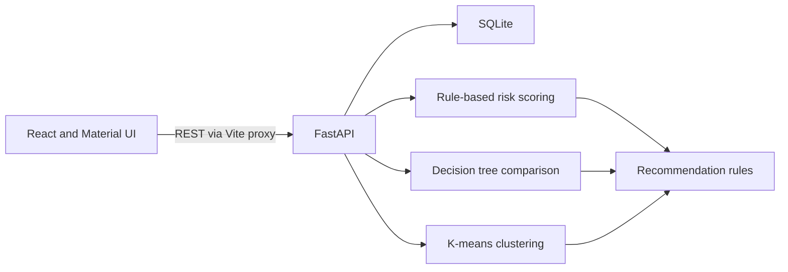

# Architecture

The Adaptive Analytics Dashboard separates presentation, API orchestration,
analytics logic, and persistence so each part can be understood and tested
independently.

## Frontend

- React routes provide dashboard, recommendations, students, engagement,
  assessments, risk review, clusters, settings, profile, and notifications.
- `CourseContext` maintains the selected course across views.
- `src/api.js` centralizes API requests and query-string construction.
- Material UI and MUI X provide accessible components, charts, and data grids.

## Backend

- FastAPI exposes course-filtered analytics endpoints and OpenAPI documentation.
- SQLite stores synthetic students, enrolments, engagement events, assessments,
  recommendation state, and notifications.
- A deterministic seed script creates 120 synthetic students across five
  courses for a fixed fourteen-week demonstration semester.

## Analytics

The canonical risk score is transparent and rule-based:

| Factor | Weight |
| --- | ---: |
| Login frequency | 30% |
| Time on task | 25% |
| Quiz performance | 20% |
| Forum activity | 15% |
| Activity recency | 10% |

Scores of 70 or above are High risk, 45 to 69 are Medium risk, and scores below
45 are Low risk. The decision tree is trained on these labels for comparison,
not as an independently validated predictor. K-means clustering provides
exploratory behavioural groupings. Recommendations consolidate the available
signals into one instructor-facing action per student.

## Data and Ethics

All student records are generated locally and are synthetic. The project does
not connect to an institutional LMS or process real student data. Its analytics
are decision-support demonstrations and must not be used as automated academic
or welfare decisions without institutional validation, governance, and human
review.
